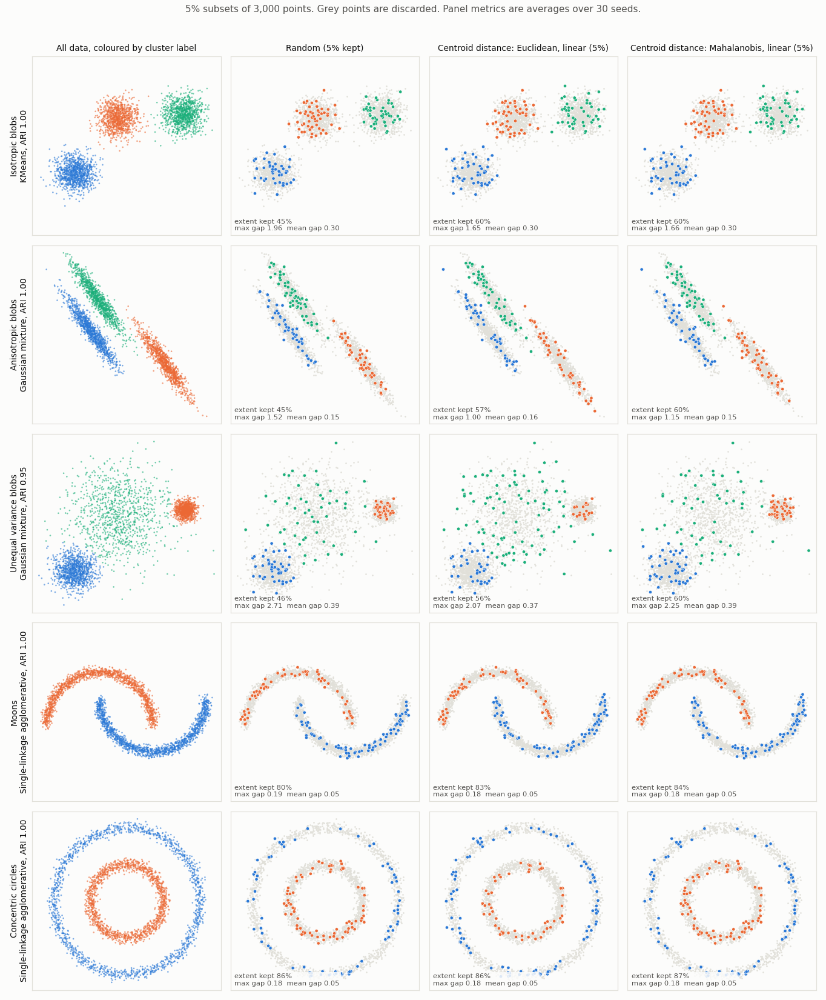
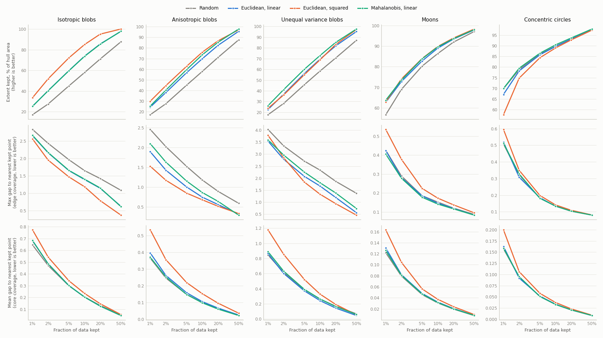

# centroid-distance-sampler

Numerosity reduction for large, clustered datasets that keeps cluster boundaries intact.

A uniform random subset thins every region equally, so the outer edges of each cluster get eroded. That hurts downstream models that need to extrapolate, such as regression near the edge of the data. This sampler instead keeps points with a probability that grows with their distance from their own cluster's centroid. Boundary points are favoured and the dense core is thinned the most.

## Algorithm

1. You cluster the data yourself and pass in **hard labels** (KMeans, GMM `predict`, DBSCAN, ...).
2. Centroid of each cluster (mean).
3. Distance from each sample to its cluster centroid: **Euclidean** or **Mahalanobis** (with covariance estimated per cluster).
4. Each distance is converted to a weight by a weight function (`"linear"`, `"squared"`, `"uniform"` or any callable).
5. Weights are normalised over the whole dataset to sum to 1.
6. `n_samples` points are drawn **without replacement** from that distribution. `n_samples` can be an int count or a float fraction in (0, 1].

Step 6 uses the Efraimidis–Spirakis exponential-race method. Its result has the same distribution as drawing points one at a time in proportion to the remaining weights, but it runs in O(n) with a single `argpartition`.

## Usage

```python
from sklearn.cluster import KMeans
from sklearn.datasets import make_blobs
from centroid_distance_sampler import centroid_distance_sample

X, y = make_blobs(n_samples=100_000, centers=5, random_state=0)
labels = KMeans(n_clusters=5, n_init=10, random_state=0).fit_predict(X)

idx = centroid_distance_sample(X, labels, 0.05, random_state=0)  # keep 5%
X_small, y_small = X[idx], y[idx]          # or df.iloc[idx] for pandas
```

Options:

```python
from sklearn.covariance import LedoitWolf

centroid_distance_sample(
    X, labels, 5000,
    metric="mahalanobis",               # scale/shape-aware per cluster
    covariance_estimator=LedoitWolf(),  # default: EmpiricalCovariance()
    weight_func="squared",              # stronger boundary emphasis
    random_state=0,
)
```

These helpers expose the intermediate steps:

| Function | Returns |
| --- | --- |
| `compute_centroids(X, labels)` | `(classes, inverse, centroids)` |
| `centroid_distances(X, labels, metric=...)` | distance of each sample to its centroid |
| `sampling_probabilities(X, labels, metric=..., weight_func=...)` | normalised sampling distribution |

### Notes

- The returned indices are positional and sorted.
- Every distinct label counts as one cluster, including noise labels such as DBSCAN's `-1`.
- A point exactly at its centroid gets weight 0 with `"linear"`/`"squared"`, and so does every member of a singleton cluster under Mahalanobis. Zero-weight points are only drawn, uniformly, once all positive-weight points have been taken. If every weight is 0, sampling is uniform.
- With `metric="euclidean"`, clusters with larger spread get more of the budget. Use `"mahalanobis"` to measure each cluster relative to its own spread.

## Examples on synthetic data

[`examples/synthetic_datasets.py`](examples/synthetic_datasets.py) runs the sampler on five of scikit-learn's 2-D datasets (3,000 points each). Each dataset is first clustered with a suitable algorithm (KMeans, a Gaussian mixture, or single-linkage agglomerative clustering), and those predicted labels go to the sampler. The script needs matplotlib and pandas.

```bash
python examples/synthetic_datasets.py
```



Each subset is scored per cluster, then averaged over 30 seeds. The numbers are in [`metrics.csv`](examples/figures/metrics.csv).

- **Extent kept:** convex-hull area of the kept points as a share of the full cluster's hull area.
- **Max gap:** the largest distance from any original point to its nearest kept point. Lower means the edge is better covered.
- **Mean gap:** the average of that distance. Lower means the core is better covered.



What the examples show:

- **Blob-shaped clusters are where it pays off.** At 5% kept, centroid-distance sampling retains about 55–72% of each cluster's hull area versus about 45% for random sampling. The worst-case gap to the nearest kept point drops by 15–45%. Mean gap, i.e. core coverage, is almost unchanged with `"linear"` weights.
- **`"squared"` weights push harder towards the edge.** They give the best extent and max gap on the blobs but visibly thin the core, so mean gap gets worse. Pick it when extrapolation matters more than interpolation.
- **Mahalanobis helps when clusters differ in spread.** On the unequal-variance blobs, Euclidean weights spend most of the budget on the wide cluster. Mahalanobis measures each cluster against its own covariance, so each cluster's edge is sampled in proportion. On round clusters it behaves the same as Euclidean, so the two lines overlap in the isotropic panel. It is also unaffected by linear transforms, which is why the isotropic and anisotropic blobs get identical extent scores.
- **Non-convex clusters gain little.** On moons and circles, every point is a similar distance from the centroid, so the weights are nearly uniform. Ring centroids also sit in empty space. Expect results close to random sampling there.

## Install / test

Requires Python 3.9+, `numpy>=1.19.3`, `scipy>=1.5.4` and `scikit-learn>=0.24`.

```bash
pip install -e ".[test]"
pytest
```
